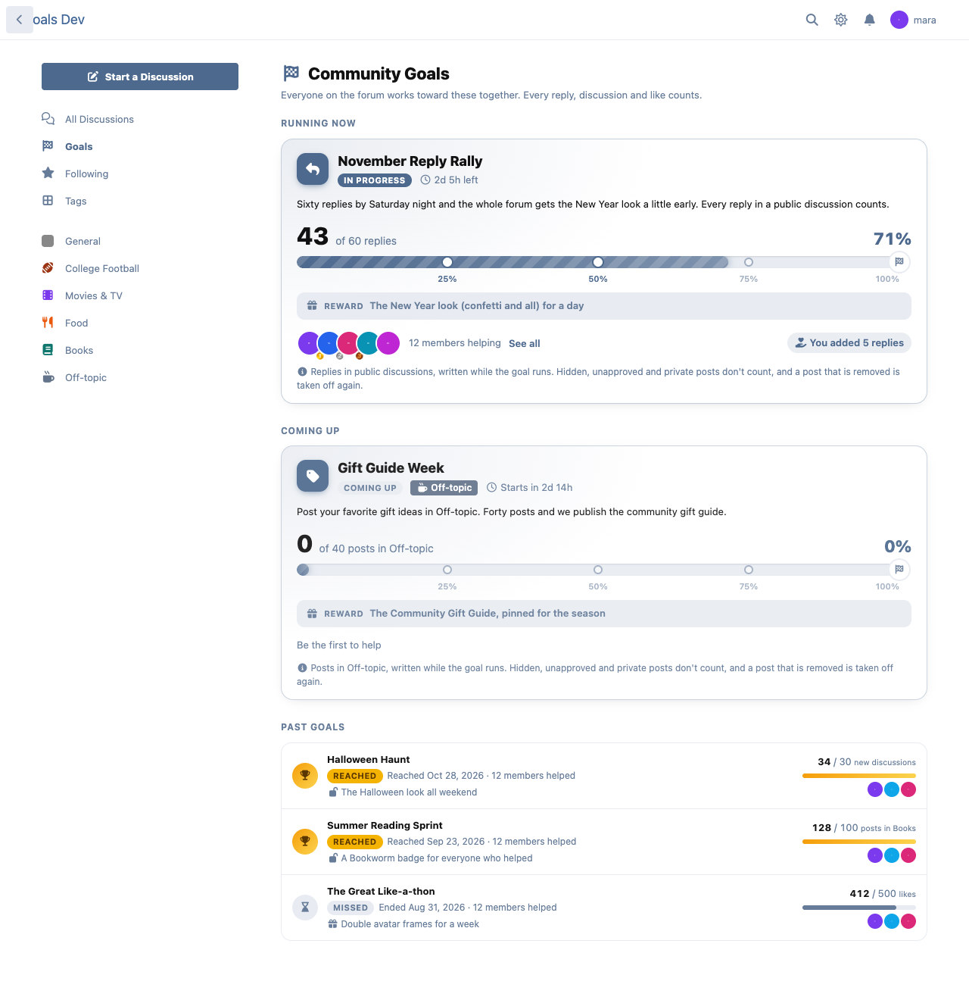
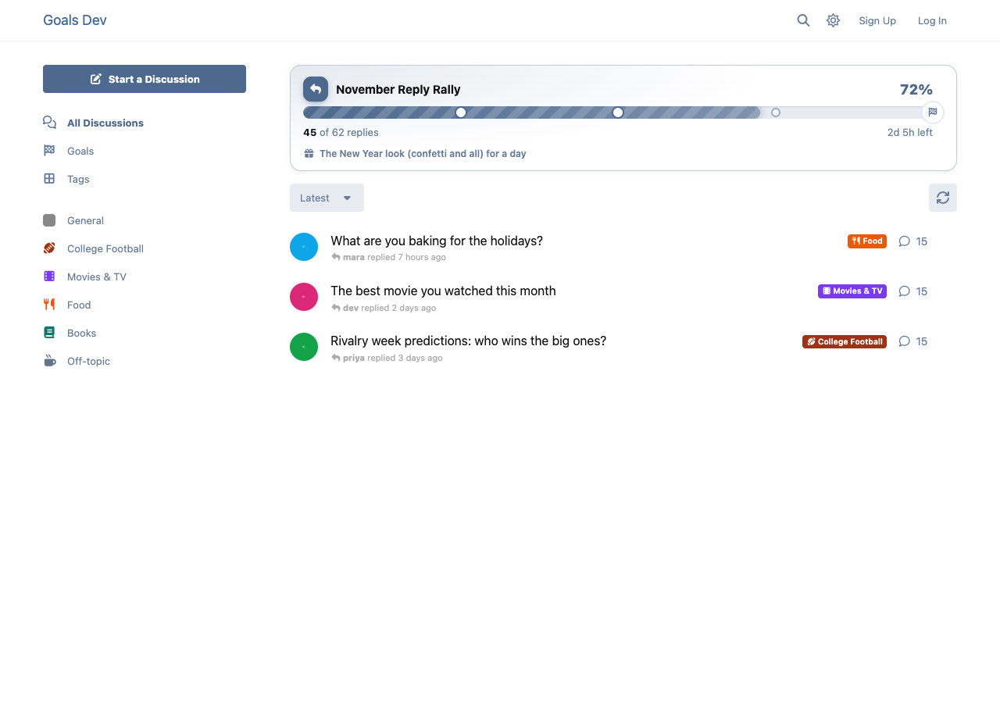
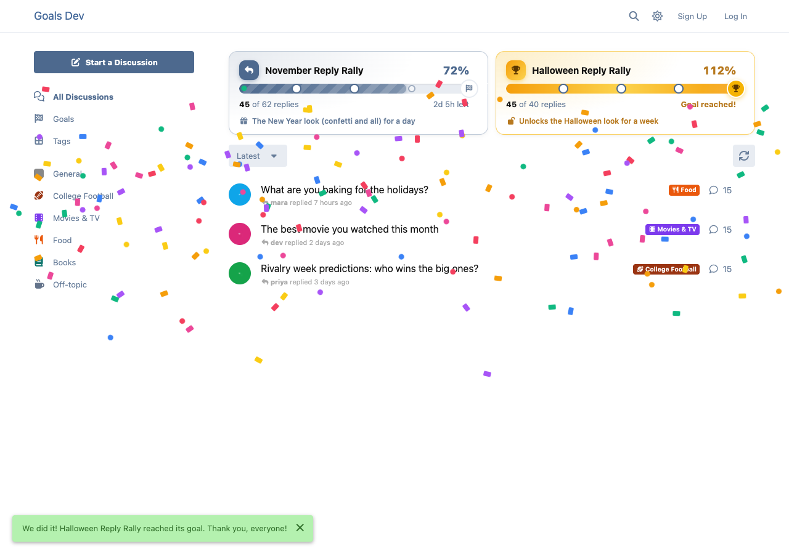
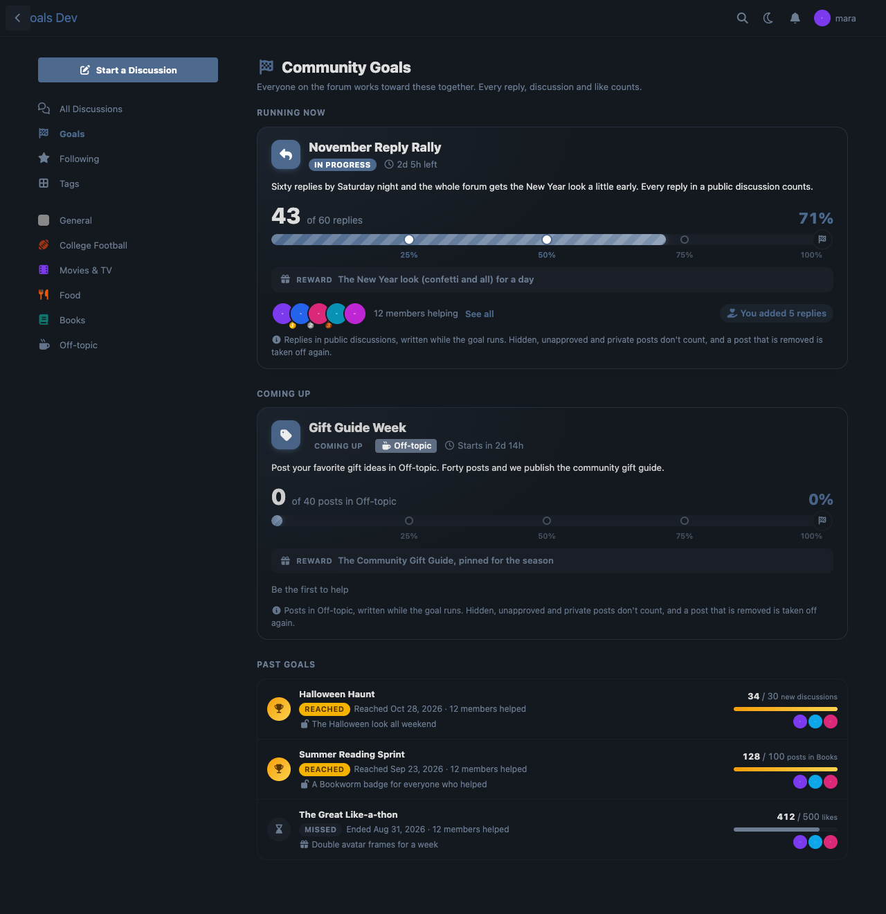
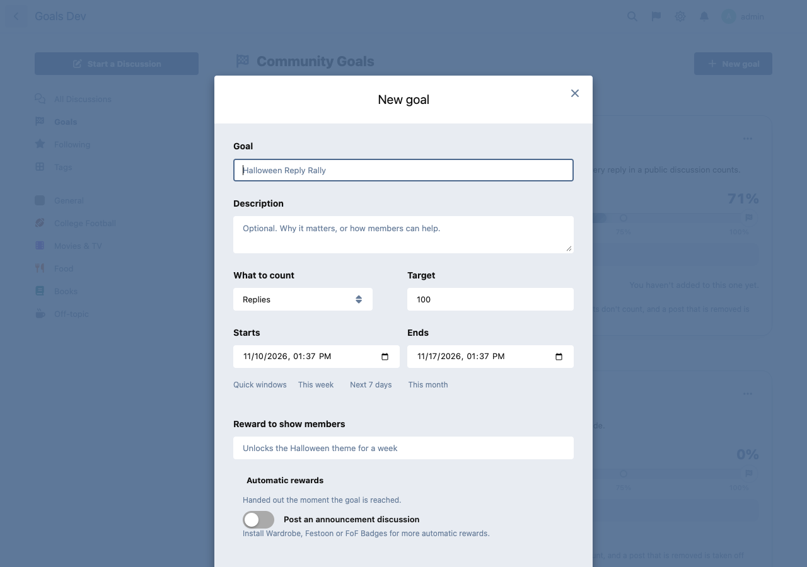

# Community Goals

The whole forum works together toward a shared target: "500 replies this week unlocks the Halloween look", "100 new members this month".

 [](https://packagist.org/packages/ernestdefoe/community-goals)



- **Goals anyone can feel.** An admin sets a goal: what to count, a target, a time window and a reward to show members. Count replies, new discussions, likes given, new members, posts in a tag, or a number your staff keeps by hand.
- **A big, satisfying progress bar** on the discussion list (a banner over the list, or a card in the sidebar) and a Goals page. Striped, animated, with marks at 25, 50 and 75% that light up as they're passed.
- **Celebrations.** Every milestone gets a burst of confetti from its mark, and reaching the goal rains confetti over the whole page, once for each member.
- **Top contributors** for every goal, with medals, and each member sees what they added and where they stand.
- **Everyone who helped is notified** when the goal is reached.
- **Automatic rewards** (each optional, each only offered when its extension is installed):
  - make a [Wardrobe](https://github.com/ernestdefoe/wardrobe) theme the forum's default, for some days or for good,
  - dress the forum in a [Festoon](https://github.com/ernestdefoe/festoon) look for a few days,
  - give a FoF Badges badge to everyone who helped,
  - post an announcement discussion with the numbers and the top helpers.
- **History.** Every past goal, reached or missed, with its final count and its top helpers.
- **Fair counting.** Only what a regular member can read counts: hidden, unapproved and private posts, and staff-only tags, never do. A post that is hidden or deleted is taken off again, and counts again if it's restored. Nobody gets credit for liking their own post.
- **Light on your forum.** The count moves one post at a time as things happen (a small ledger makes that exact, so duplicate events and restores never double-count); the number is cached on the goal, and the banner rides in the page's own data from the cache. Nothing is recounted on a page view.
- **Permissions** to view goals (guests by default) and to set them (admins by default, can be given to moderators).
- **GDPR**: with Flarum's GDPR extension, a member's contributions are in their data export and are removed on erasure.

| | |
|---|---|
|  |  |
|  |  |

## Install

```sh
composer require ernestdefoe/community-goals
```

Then open **Goals** in the forum's sidebar and set the first one.

## Update

```sh
composer update ernestdefoe/community-goals
php flarum migrate
php flarum cache:clear
```

## Good to know

- Goals close a few minutes after they end (Flarum's scheduler runs `community-goals:tick`), and timed rewards are taken back the same way. Make sure the scheduler is running.
- Set a goal that started in the past and it counts what already happened. If a count ever looks off, **Recount** in the goal's menu (or `php flarum community-goals:recount`) rebuilds it.
- Once a goal is reached it stays reached, even if a post is removed afterwards. It keeps counting until its window ends.
- A goal whose target is already met when you save it would be reached on the spot; the form asks before it does that.
- Automatic rewards can only be set by admins, even if moderators may set goals.
- Changed which groups can see a tag? Use **Recount** on goals that count it: the count follows posts as they change, not permission edits.

## Links

- [Packagist](https://packagist.org/packages/ernestdefoe/community-goals)
- [GitHub](https://github.com/ernestdefoe/community-goals)

## Support

If Community Goals is useful to you, you can [buy me a coffee](https://buymeacoffee.com/ernestdefoe). ☕
